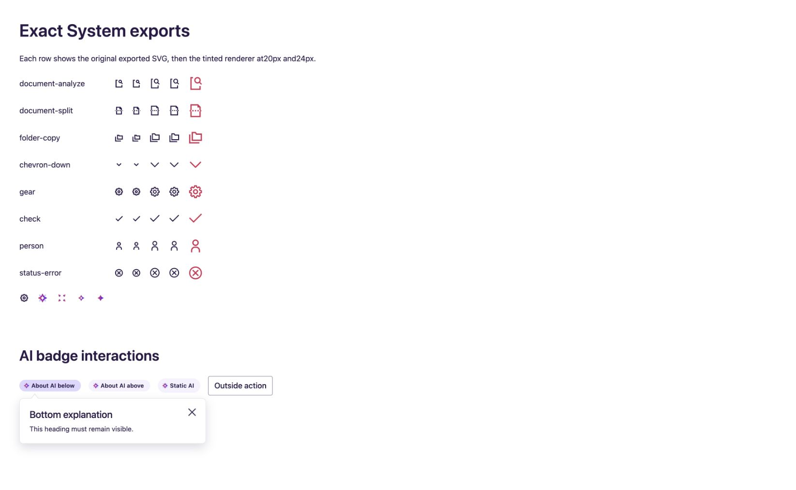
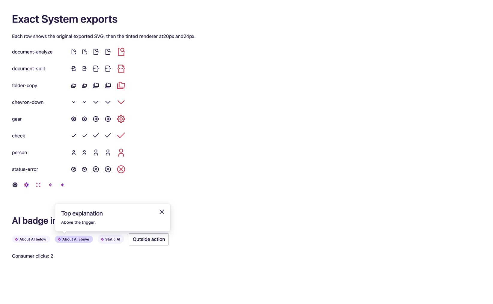

# AI Badge functional repair evidence — 2026-10-20

Authoring source: `/private/tmp/protolab-foundation-repair/ink/protolab-source/src/design-system/4-composites/AIBadge`. Source TSX/CSS is frozen for the integrated refresh; generated starter files were not edited.

| Confirmed defect | Repair | Verification |
|---|---|---|
| calloutPosition ignored | Calls actual shared Callout `location="above"/"below"` and `alignment="start"`; wrapper positions above/below. | SSR verifies actual Callout classes; Cua checks dialog rectangle above/below its trigger |
| Fragile first-child/caret selectors hide updated heading | Removed custom caret/hiding overrides; shared Callout owns its caret and heading. | Cua sees both headings and their rendered height; screenshots below |
| Span impersonates a button | Interactive badge is a named native `button type="button"`; `infoContent={false}` remains a span. Public Span event attribute types remain accepted. | Rendered semantics/type tests; Cua button accessibility tree |
| Unassociated popup and weak keyboard/focus behavior | Trigger has expanded/haspopup and an open-only controls ID; nonmodal dialog has stable ID and heading association. Opening focuses dialog; Escape and close restore trigger focus. Outside click dismisses and preserves outside focus. | Cua ID resolution, focus observations, Escape, close and outside-action checks |
| Native activation could double-toggle | Native button handles Enter/Space; consumer click/key handlers retain preventDefault semantics. | Cua Space activates once, increments consumer click counter once, and opens once |

Root-owned IrisIcon/Inverse wrappers still delegate exact AIIcon. Existing open/onOpenChange controlled behavior is retained. An always-present wrapper is now a div so it can legally contain the block Callout. Its inline-flex presentation is retained; consumers relying on the wrapper's old literal span tag should review that structural change.

`tests/ai-badge.test.ts` has four meaningful semantic regressions. The complete 47-test primitive/icon/badge suite and strict React 19/ES2020 source tsc pass. Cua tested the authoring-source fixture at `/tests/fixtures/standard-icons.html` using the Chrome extension. No terminal browser automation was used for this wave.

The historical AI Badge Figma target remains unresolved. These are functional and structural fixes, not a fresh Figma visual-match claim. The integrated starter refresh and bounded root dialog/focus check now pass; see browser/root-checks.json. The native IAB upload filepicker was inaccessible to the integrator; this wave adds no FileUpload runtime claim and preserves the earlier primitive tests/evidence.
