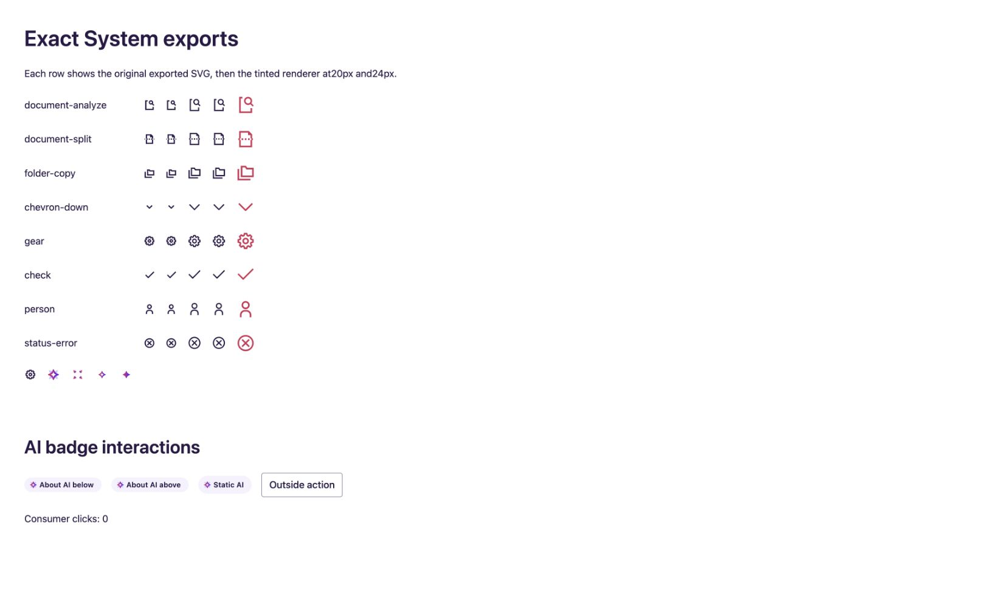

# Standard Icon repair evidence — 2026-10-20

Authoring source: `/private/tmp/protolab-foundation-repair/ink/protolab-source/src/design-system/3-primitives/Icon`. The starter generated source was not edited. The source is frozen for the integrator's refresh.

## Exact asset provenance

Read-only PluginAPI exports from [System icons](https://www.figma.com/design/Y7VyYvcCvXjG1pgeXicozZ?node-id=0-1) used `exportAsync({ format: 'SVG_STRING' })` with default SVG export settings. The figma-use skill and SVG export API documentation were read before execution. No Figma nodes, settings or variables were changed.

All 582 active System masters are saved intact under `Icon/assets/system/`: 291 independent small masters with 20×20 root bounds and 291 medium masters with 24×24 root bounds. Their node IDs exactly match the accepted `system-icon-geometry.json.gz` inventory. Excluded deprecated masters remain excluded. Export transport used six losslessly compressed chunks of 97 records because larger responses exceeded the tool's output cap. No exported geometry, paint, clipping or SVG markup was rewritten. Total SVG bytes: 250,530. `provenance.json` records every node, source name, bounds, filename and SHA-256.

The three missing families now have exact paired exports:

| Family | Medium master | Small master |
|---|---|---|
| documentAnalyze / document-analyze | 7426:71 | 7426:72 |
| documentSplit / document-split | 7426:73 | 7426:74 |
| folderCopy / folder-copy | 7426:75 | 7426:76 |

## Findings and source changes

| Finding | Repair | Evidence |
|---|---|---|
| Small geometry was a scaled medium path | `size="small"` selects its independent 20px SVG; medium selects 24px. Numeric dimensions stay explicit, choosing the small optical master at ≤20px. | 582 paired geometry/hash tests; Cua reference matrix |
| Missing analyze/split/copy names | Added exact assets; camelCase, kebab-case and underscore normalization resolves current names. | Both sizes and naming styles tested |
| Asset fidelity and color handling | Whole SVG files supply alpha masks; native SVG rect uses explicit `color`, `fill`, or inherited `currentColor`. The common 90% source paint opacity is normalized to geometric coverage before applying caller opacity once. Antialiasing remains proportional. No System paths are reconstructed or embedded in React. | All 574 monochrome masters' base opacity checked; attached alpha-normalization filter tested for default/white/half-alpha paints |
| Existing names must remain usable | Preserved all nine aliases and six original local extension paths in `legacyIconFallbacks.ts`. The historical `ai-iris-filled` extension entry is retained, while runtime delegates the alias to AIIcon as coordinated. | Alias/extension regression test |
| Generic AI names | `ai-iris`, `ai-iris-filled`, `ai-iris-inverse`, `ai-spark`, `ai-spark-filled` delegate to the exact colored AIIcon implementation. | Five-name delegation test |
| Broad arbitrary prop indexer | Replaced with SVG-compatible native props and a forwarded SVG ref; preserved dynamic string names, native labels, dimensions, opacity, events and styles. Repeated masks receive unique useId-based IDs. | Strict React 19/ES2020 tsc; semantic/ref type coverage |
| Bundle payload | Vite URL glob uses `?url&no-inline`; all 582 System SVGs emit as external files rather than inline SVG payloads. | Production build: 582 URL entries, 582 files, all 582 source SHA-256 values present |

No edits were made to Icon.module.css, root-owned AI asset files, or global public barrels. The old complete `iconPaths.ts` remains preserved but is no longer imported by the standard Icon renderer.

## Verification

- `node node_modules/typescript/bin/tsc -p primitive-check.tsconfig.json`: passed. Complete Ink source, strict React 19 and ES2020; only the established `.figma.ts` exclusion.
- `node node_modules/vitest/vitest.mjs run --config tests/primitive-foundation.config.ts`: 47 passed (33 primitive, 10 exact System icon, 4 AI Badge tests).
- `node node_modules/vite/bin/vite.js build --config tests/standard-icons.vite.config.ts`: passed under the source runtime's Vite 7.3.1. Starter Vite 6.4.1's installed implementation also explicitly supports `no-inline`.
- Build inspection: 582 unique original hashes, 582 emitted System SVGs, zero missing hashes, 582 external URL references. The fixture's combined JavaScript is 365,122 bytes because it imports the shared barrel. Thirteen other SVG data URLs belong to twelve direct AIIcon assets and one existing Hotspot asset; none is a System master.
- Cua Chrome fixture compared original export and renderer pairs for document-analyze, document-split, folder-copy, chevron-down, gear, check, person and status-error. All 16 original image references loaded at 20/24px. Small output measured 20px; medium output measured approximately 24px at browser scale. Explicit red 32px tint was visible. No captured console errors or warnings.
- Final integration caught that raw source 90% alpha multiplied caller 90% text paint to 81%. The renderer now normalizes source alpha with a linear transfer slope of `1 / 0.9`; the original SVG files/hashes remain unchanged. Tests and strict tsc pass after this correction. The screenshot and asset build above predate that final renderer correction; they establish geometry/asset serving, while final corrected-tint browser evidence belongs to the integrated run. Fixture comparison paint now uses the default 90% text token.

This verifies representative geometry and behavior, not a 582-glyph pixel-diff certification, every browser's external SVG-mask behavior, SSR asset serving, or every arbitrary slot arrangement. The integrated starter refresh and full app browser verification remain the integrator's responsibility. Screenshots are evidence only and are not code assets.

## Integrator closure

Final private bundle `16c70f74eb3e3ee2` is refreshed with source hash equality. Starter typecheck/build pass and the app source audit has zero findings. Bounded CUA checks are recorded in [browser/root-checks.json](browser/root-checks.json), with final icon tint evidence in [browser/icon-final-tints.png](browser/icon-final-tints.png). Historical wave notes above retain their original scope; no exhaustive raster/variant or successful native-picker claim is made.
