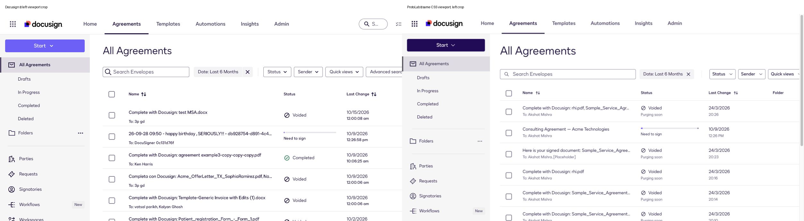
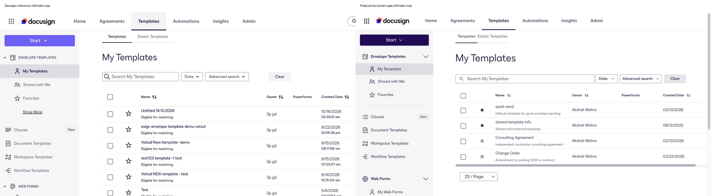

# Key-screen alignment — 2026-10-20

The user clarified the target: match the recognizable Docusign screens and use
the Figma system consistently; complete production flows, exact content insets
and exact row density are not required. Production itself varies. This pass
prioritizes Home, Agreements and Templates and keeps live Docusign read-only.

## What changed

| Screen | Change | Verification |
|---|---|---|
| Shared navigation | Added Automations and Signatories as context items, updated Workflows naming/badges and header utility icons | Rendered in the prototype; contextual items do not imply implemented product flows. |
| Home | Earlier light welcome area, summary/actions, Tasks/activity/Templates and responsive footer improvements retained | See the [Home/detail pass](protolab-home-and-detail-alignment-2026-10-20.md) and [final running Home capture](fidelity-evidence/2026-10-20/28-protolab-home-final.png). |
| Agreements | Existing compact layout prop, Folder column, representative signing-progress row, source-style filter labels and restrained row density | Source23 and local26 captured. Names truncate within their cells; visual composition compared below. The density is an approximation, not a new exact-match requirement. |
| Templates | Added Templates/Elastic Templates tab context, grouped sidebar, Clauses/Workspace Templates context, selection/favorite column and production-style table headings | Source25 and local27 captured. Search reduced four fixture rows to one; Clear restored four. Corrected overflowing name/description text. |

These are left-side crops: the source viewport was 1576px wide and the local QA
iframe used that CSS width, while the browser capture area was narrower. The
comparisons support screen structure and hierarchy, not a whole-screen pixel
match. The prototype uses its own fixture names/counts. Wide tables can scroll.
The temporary QA HTML was removed after verification.

## Scope and limits

Search, Clear, existing view navigation and table selection remain available.
Context controls such as Automations, Signatories, favorite toggles, Use and
advanced filter menus are not represented as complete flows. Elastic Templates
is disabled. Deepen those behaviors when an experiment depends on them.

All new UI composes installed components from the design-system barrel.
Generated sources and Figma were not edited. Primary actions retain the
installed Ink variant; no page-specific color was invented to reproduce the
development account's purple buttons.

`npm run build` passes. The [static source audit](fidelity-evidence/2026-10-20/design-system-audit-key-screens.json)
passes with 173 existing findings, zero new findings and 28 original baseline
occurrences resolved. This is a source-use check, not a visual similarity score.
[Typecheck](fidelity-evidence/2026-10-20/typecheck-key-screens.txt) reports 61
existing generated-source diagnostics and zero app-owned diagnostics. Those
contract problems remain a foundation priority.

The [comprehensive Figma review](figma-library-review-2026-10-20.md) is a separate
component-level audit. It distinguishes systematic inventory/code checks from
rendered visual comparisons and prioritizes reusable component gaps over
ordinary production spacing variation.
