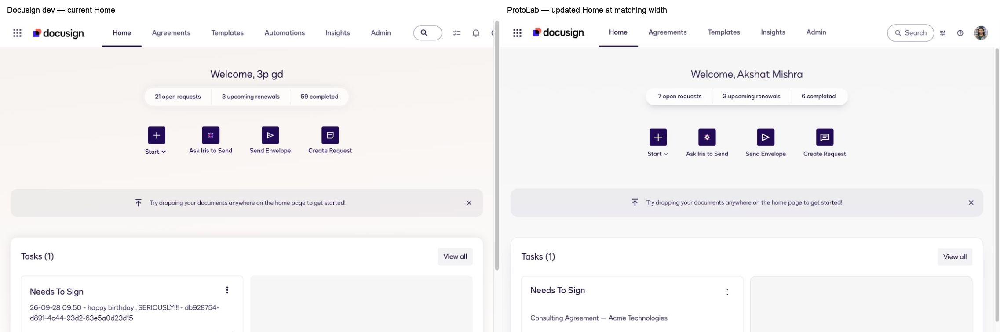
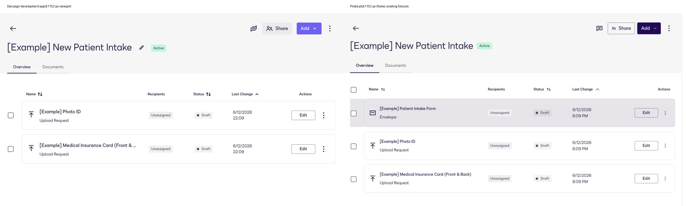
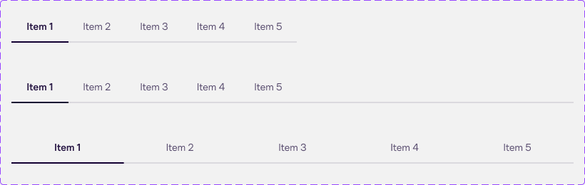

# Home and detail alignment — 2026-10-20

The subsequent [key-screen pass](key-screen-alignment-2026-10-20.md) records the
latest Agreements/Templates and shared navigation changes. The screenshots and
checks below describe this earlier stage.

This pass follows the initial [positioning review](protolab-positioning-2026-10-20.md).
Its current target is [credible, scoped prototype fidelity](prototype-readiness.md),
following the user's clarification that complete production replication is not
required. No visual-parity percentage is claimed.

## Changes and verification

| Surface / step | Current result | Evidence and limits |
|---|---|---|
| Home composition | Light welcome area, summary pill, four actions, drop hint, full-width Tasks/activity/Templates, populated and empty task fixtures | Existing matched Home comparison below. Fixture counts, document previews, navigation coverage and action ordering differ from the live account. |
| Envelope entry | Full-screen composition with Ink controls, recipients, message and local draft review | Entry screenshot14. The review step is a prototype extension; it does not reproduce the production tagging editor. Sending and uncaptured options are disabled. |
| Draft creation and editing | Sidebar Start envelope actions open the same composer. Save adds a local Drafts row. Edit restores recipient, subject, message and signing order; saving a revision updates the existing row | Browser exercised create → Save → Edit → revise → Save; list count stayed at four and the edited title changed in place. Files remain session-local; upload selection itself was not browser-verified. Reload clears this prototype data. |
| Home hint / Iris | Hint dismissal works; Ask Iris opens the installed assistant and Close returns to the page | Browser verified. The assistant is the existing general Iris prototype; a dedicated sending conversation is still a separate experiment. |
| Narrow Home / footer | 375px iframe renders wrapped actions and empty Tasks. Footer now wraps and uses real Ink Links | Screenshots19–20. The visible horizontal scrollbar disappeared after the footer repair. This is local layout evidence, not a mobile production comparison. |
| Workspace Overview | Semantic selectable DataTable replaces custom grid, Card rows and native checkbox. Token CSS retains separated borders outside the selection column | Fresh source17 and local21 at a 1152px target viewport, comparison below. All three local fixtures retained; source has two. |
| Workspace selection / sorting | Individual selection, mixed/select-all/clear states and Name sorting work | Browser verified mouse and Enter-key Name sorting. Status/Last Change are wired, but homogeneous fixture values do not prove their ordering behavior. |
| Shared detail tabs | Workspace and Request use namespaced Ink Tabs with neutral selected underline | Workspace Documents and Request Details rendered the intended panels. The generated Tabs component still lacks arrow-key navigation. |

The Workspace comparison shows the local row under the pointer. Its hover fill,
extra fixture and time format should not be mistaken for an identical-data pixel
comparison. The shared component still adds a select-all checkbox absent from
the source header. The prototype also lacks the source title-edit action; the
captured Workspace Settings dialog was not implemented after the fidelity
target was clarified.

## Figma and system adherence

Fresh [Tabs context 875:21503](https://www.figma.com/design/nAKX1rO3Mir2OCBdCkC5oq/-ds-ui--Component-Library?node-id=875-21503)
returned Code Connect and a screenshot with neutral selected styling, 14px type,
600 selected/400 unselected and 1.4 line height. The implementation adapts that
context to the installed Tabs API through the design-system barrel.

All changes are app-owned. No generated design-system/AI files or Figma content
were edited. Separated table-row styling is currently scoped CSS because the
installed DataTable has no corresponding variant; promoting it upstream would
make it easier to reuse.

Current [static audit](fidelity-evidence/2026-10-20/design-system-audit-phase-2.json):
**173 existing findings, zero new, 28 baseline occurrences resolved** from the
original 201. Remaining categories: 24 native controls, 25 literal colors,
56 typography,45 spacing and 23 layout bypasses. No app-owned unknown tokens or
deep design-system imports were found. These counts describe source usage and
do not measure visual similarity.

`npm run build` passes. `npm run typecheck` still fails with **61 diagnostics,
all in generated sources; zero app-owned diagnostics**. No failures were
suppressed. See [the current log](fidelity-evidence/2026-10-20/typecheck-phase-2.txt).
The [upstream repair package](../patches/2026-10-20-upstream-contracts/README.md)
removes those diagnostics in an isolated compatibility copy; it has not been
applied or released. See [token resolution](token-resolution-2026-10-20.md) for
the evidence-backed replacements and unresolved semantics.

## Remaining priorities

1. Deliver compatible shared type/token contract repairs through the authoritative
   sources. Preserve newer starter APIs when reconciling source drift.
2. Improve reusable patterns used by actual prototype experiments, including
   accessible Tabs behavior, table row variants and remaining native controls.
3. Deepen the particular flow under test when an experiment needs it. Existing
   placeholder actions, backend persistence and unrelated settings are not
   represented as complete product capabilities.

Live Docusign is read-only for subsequent reference work. The user elected to
leave the previously created empty reference draft in place. This pass did not
send documents or apply edits/deletions to that account.
