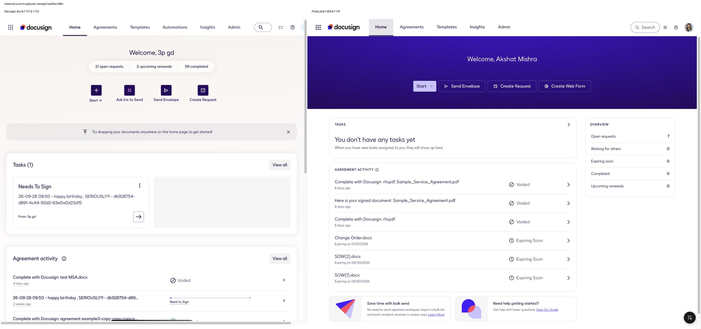
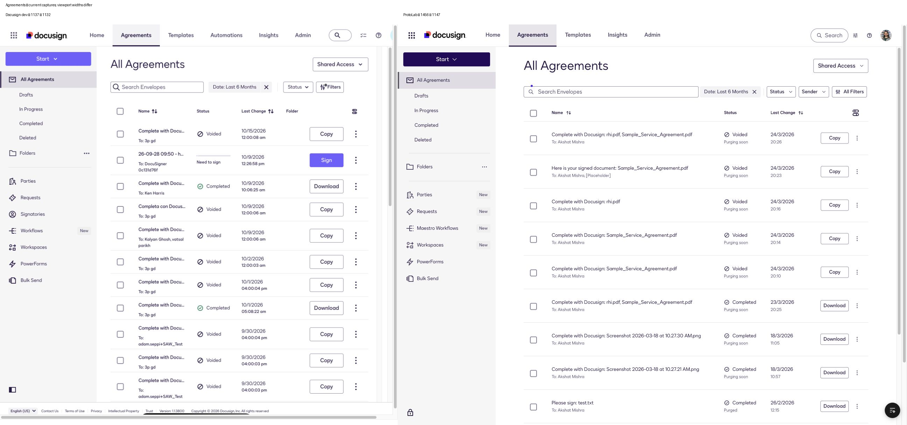
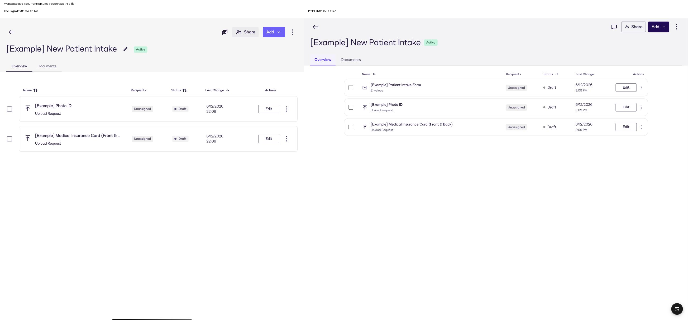
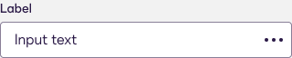

# ProtoLab positioning review — 2026-10-20

This is the initial snapshot. The later [Home and detail alignment pass](protolab-home-and-detail-alignment-2026-10-20.md)
supersedes its Home/workspace implementation findings and source counts. The
current goal uses [scoped prototype fidelity](prototype-readiness.md), following
the user's clarification that complete production replication is unnecessary.

ProtoLab has a useful Docusign component foundation, but production fidelity is
uneven and the starter still contains examples that bypass its own rules. It is
usable for prototyping; it is not yet verified as a consistently faithful base
across the product. This review starts the improvement work and keeps the two
goals separate: resemblance to the current product, and faithful system reuse.

## Evidence and limits

The current run inspected the local source and rendered prototype, the signed-in
[Docusign development app](https://apps.dev.docusign.net/send/home), and the
[Figma component library](https://www.figma.com/design/nAKX1rO3Mir2OCBdCkC5oq/-ds-ui--Component-Library?node-id=3140-1301).
Three parallel code reviews covered view usage, Figma coverage, and repeatable
static checks. Screenshots below were captured and inspected during this run.

The Docusign account, data, release and feature configuration differ from the
prototype. Captured viewport widths also differ: Home and Agreements are
1137px versus 1456px; workspace detail is 1152px versus 1456px. These images prove
structural differences, not precise spacing, responsive or pixel parity. No
visual-fidelity percentage is justified by this evidence. Fine-grained geometry
must be compared again at matched viewports and states.

## Current position

| Dimension | Evidence | Assessment |
|---|---|---|
| Reusable foundation | One shell, 3 table-view layouts and 7 DataTables in App.tsx; installed typography, tokens, icons and utilities | Strong starting structure |
| Current production composition | Home, Agreements and workspace detail compared below | Partial; Home is the largest sampled divergence |
| App-owned system adherence | New AST/CSS audit: 201 existing findings across 6 files | Significant existing debt; new detected regressions now fail |
| App type correctness | 0 app-owned diagnostics after this pass; all 7 column arrays typed | Improved and directly checked |
| Generated library correctness | 61 type diagnostics and 14 missing token names / 38 references | Requires upstream repair and compatible refresh |
| Figma mapping | 37 local template files, 36 target URLs; Button sampled live | Useful translation coverage; mapping presence does not prove visual parity |
| Interaction and accessibility | Navigation exercised; raw controls and unnamed controls observed | Partial evidence; no full accessibility or behavioral certification |

## Captured comparisons

### 1. Home

Both surfaces retain the Docusign identity, welcome, tasks and agreement
activity. The live account uses a light hero, a summary pill, four icon actions
including Ask Iris to Send, a document-drop hint, full-width task/activity
sections and View all actions. ProtoLab uses a purple hero, outlined horizontal
actions, a right-hand Overview card and an empty task state. Data differences
explain the empty versus populated task state; they do not explain the different
hero and action hierarchy. Global navigation also lacks Automations in ProtoLab.

Next: match the current Home composition with the existing shell, layout,
Button/IconButton, TaskCard, Card and typography components. Use representative
fixtures and working navigation. Verify both populated and empty task states.

### 2. All Agreements

The shell, sidebar, title, search/filter row and table are recognizable and
structurally close. The live sidebar adds Signatories, labels Workflows
differently, and uses a different set of New badges. ProtoLab has additional
filter controls, lacks the visible Folder column, and renders a taller-looking
row composition. The unequal viewports and different fixtures prevent a precise
density comparison. The live Start appearance also differs; its sanctioned
variant belongs in the shared navigation API rather than a page CSS override.

Next: reconcile navigation and filter/column configuration against the target
release, then compare at the same viewport using equivalent row content.

### 3. Workspace detail

The title, back action, status, tab names and primary actions follow the same
overall pattern. Production has an edit-title action, neutral active tabs and
spaced table rows with selection outside each bordered row. ProtoLab uses a
hand-built grid, a Card for each row, a native checkbox and purple selected tabs.
The live page exposes a semantic table in its accessibility tree; the prototype
grid does not. The number of fixture rows differs and is not itself a defect.

Next: express this screen through DataTable and Tabs. Preserve the production
row treatment through an upstream table variant if the installed props cannot
represent it. A plain table conversion alone would improve reuse while losing
part of the visual target; that tradeoff is not a completed fix.

## Figma grounding

The supplied node `3140:1301` is the Thumbnail page, not a component specimen.
The live page inventory was used to locate component nodes. The current
[primary medium Button, 10:541](https://www.figma.com/design/nAKX1rO3Mir2OCBdCkC5oq/-ds-ui--Component-Library?node-id=10-541)
returned Code Connect context for `@ds/ui` and a screenshot. Its 80×40 specimen
and DS Indigo 16px/500 typography agree with the installed Button's corresponding
size/type configuration. This is a sampled configuration check, not proof of
all button states or colors.

The current
[medium Text Box, 144:17003](https://www.figma.com/design/nAKX1rO3Mir2OCBdCkC5oq/-ds-ui--Component-Library?node-id=144-17003)
was also captured at 320×64. The context endpoint reported missing server-side
mapping for this node; a local `.figma.ts` file does not prove that a connection
is published to Figma. No mapping was published or library content changed.

The local crosswalk has been corrected: Popover's file is an unresolved stub,
Timeline is already exported, and July icon/variant findings are historical.
See [the current mapping notes](figma-code-connect.md) and
[translation instructions](figma-to-prototype.md).

## Changes delivered in this pass

- Replaced nine distinct undefined app-owned token names with installed tokens.
  The existing icon/token checker now reports no app-owned unknown names.
- Replaced unsupported Badge kinds and size props with supported variants;
  removed the Beta badge's custom color override.
- Typed all seven existing table column arrays and corrected ignored alignment
  props. Existing fixture actions and React element typing now type-check.
- Added hidden labels to the existing detail-search and page-number Inputs,
  guarded an optional scripted response, and tokenized the light page headings.
- Enabled Vite client types. Diagnostics dropped from 191 to 61: 117 were
  missing Vite declarations and 13 were app errors corrected here. All remaining
  diagnostics are inside generated sources, not suppressed.
- Added `audit:design-system`, its reviewed debt baseline, JSON output, 16
  parser/CLI tests, and usage documentation. It fails on new detected debt while
  keeping existing debt visible.
- Repaired the packaged build script so missing/unsafe metadata and copy
  failures stop before dependency work. Seventeen safety scenarios passed.
- Updated stale guidance and created a reproducible
  [upstream issue register](design-system-upstream-issues.md).

Neither generated source directory was edited. No library, UI package, Figma
write, deployment, or external publication was added.

## Remaining work, in priority order

| Priority | Work | Evidence required for completion |
|---|---|---|
| 1 | Bring Home and shared navigation to the current target release | Matched-viewport before/after screenshots; populated/empty states; working entry points |
| 1 | Repair generated library contract defects upstream | Clean full type check; no unresolved token references; refresh provenance |
| 1 | Remove hand-built controls and decorative search fields from reusable examples | Lower static debt without new exemptions; browser interaction checks; retained visual target |
| 2 | Add required PageHeader, Iris CTA and spaced-table-row capabilities upstream | Figma/production specimens plus supported props and states |
| 2 | Verify component states systematically | Button, Input, Select, Checkbox, Badge, Tabs, menus, overlays and tables at normal/hover/focus/disabled/error states where applicable |
| 2 | Audit remaining product surfaces | Templates, Insights, Parties, Requests, PowerForms, Admin and Iris against current production; detail and empty states included |
| 3 | Make the same checks run in each supported authoring workflow | A representative change in each tool follows the barrel/layout/token rules and passes checks |

Use live product evidence for composition and behavior, and Figma for component
appearance and semantics. When they disagree, record the release/configuration
and resolve the shared API upstream. Do not hide the disagreement with a local
component fork or an unverified blanket override.

## Verification record

- Local Vite production build: passed with installed dependencies. The packaged
  Cowork build is a different path requiring `.protolab.json`.
- App-owned token/icon check: no findings.
- Full TypeScript check: fails with 61 known generated-source diagnostics.
- Static audit: 201 existing findings, 0 new. Categories: 27 raw controls
  (including 8 anchors), 34 colors, 61 typography, 49 spacing/radius, 30 layout.
  These are source findings, not rendered component counts or a compliance score.
- Audit tests: 16 passed, including duplicate/new-debt and invalid-baseline cases.
- Build safety checks: 17 scenarios passed using isolated subprocess stubs.
- Browser checks: Home and Agreements render; workspace detail opens and closes;
  Templates and Insights render with corrected badges and headings. Production reference steps were
  read-only. Additional post-change screenshots are in the evidence folder.

Untested: exhaustive component states, keyboard/screen-reader flows, contrast,
all supported viewport sizes, every product screen, production mutations and
end-to-end data services. The objective remains open until those scope-appropriate
checks and the listed repairs are complete.

Detailed evidence: [static findings](fidelity-evidence/2026-10-20/design-system-audit.json)
and [full type diagnostics](fidelity-evidence/2026-10-20/typecheck.txt).
